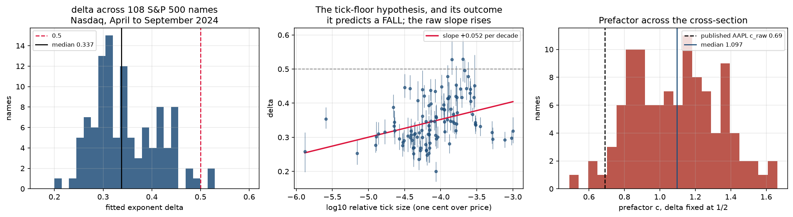

# Market Impact and Optimal Execution

I measure how much trading moves prices on Nasdaq order-level data, test which
impact model predicts that cost for a specific order out of sample, and use the
best model to schedule a large order across the day.

A large order pays for the price move it causes, so an execution desk needs a
cost estimate for a given order before it trades. Most impact studies report how
well flow explains price changes in the same interval, which cannot be acted on.
The main test here is out of sample: models are fitted on the first 70% of each
session and scored on orders that start in the last 30%.

## Results

Sample: 15 symbol-days of Databento `XNAS.ITCH` order-by-order data (MSFT, INTC
and AAPL, five sessions each in 2024), plus a cross-section of 108 S&P 500 names
built from Nasdaq trades, April to September 2024.

- **Order-level cost model.** The square-root law `I = c σ √(Q/V)` with σ scaled
  by a time-of-day profile from the same stock's prior sessions reaches a median
  out-of-sample R² of 0.206 and a calibration slope of 0.955 (12 sessions that
  have a prior session). The same law with a constant daily σ scores -0.327 with
  slope 0.519 on all 15. [model_comparison.csv](reports/conditional_impact_corrected/model_comparison.csv)
- **Explaining versus predicting.** Flow in the same second explains 0.198 to
  0.542 of one-second returns; flow from earlier seconds explains -0.0010 to
  +0.0056. [per_session.csv](reports/panel/per_session.csv)
- **Impact exponent across 108 stocks.** On 1,017,071 proxy metaorders the
  pooled exponent is δ = 0.309 [0.306, 0.313], and 101 of the 108 per-stock
  bootstrap bands exclude 0.5. [pooled_fits.csv](reports/cross_section/pooled_fits.csv),
  [per_stock_fits.csv](reports/cross_section/per_stock_fits.csv)
- **Tick size does not explain the low exponent.** In a cross-sectional
  regression, relative tick size has t = -1.10 and dollar volume t = +7.19.
  [regressions.csv](reports/cross_section/regressions.csv)
- **Displayed-book cost curve.** A flat cost followed by a power-law tail beats
  pure power-law, logarithmic, linear and fixed-exponent (3/5) forms on
  leave-one-day-out CV and AIC. The flat region ends at 0.08 of touch depth,
  well short of the full depth the original model assumed.
  [form_comparison_pooled.csv](reports/bookwalk/form_comparison_pooled.csv)
- **Execution schedule.** Priced by its own model, the KKT schedule saves a
  median 2.5% against TWAP (12 of 12 sessions). Priced by coefficients refit on
  held-out orders, it costs 7.5% more than TWAP (0 of 12).
  [pooled_summary.csv](reports/schedule_conditional/pooled_summary.csv)



## How it works

1. Build the data. From Databento MBO and ten-level book data I build
   one-second bars (signed volume, mid), proxy metaorders (maximal runs of
   same-signed fills) and ten-level book snapshots for each session. Only these
   derived series are committed.
2. Split in time. Each session is split 70/30. For the cost-model comparison,
   every parameter, including hyperparameters, is fitted inside the first 70%;
   orders starting in the last 30% are scored on realised against predicted
   impact with no refit.
3. Compare cost models. Eight models compete: a distributed-lag propagator
   (raw and with a fitted level) and the square-root law with daily, trailing,
   blended or time-of-day volatility, or with a participation-rate term.
   Time-of-day profiles come only from other sessions of the same stock.
4. Fit the displayed book. Walking ten levels every second gives the cost of
   a marketable order by size. Five functional forms are fitted by weighted
   nonlinear least squares with robust errors, leave-one-day-out CV and a block
   bootstrap by day.
5. Scale to a cross-section. I draw 108 S&P 500 names by stratifying on tick
   size and dollar volume, rebuild proxy metaorders from 30-second bins of
   Nasdaq trades, fit `I/σ = c (Q/V)^δ` per stock and regress δ on stock
   characteristics.
6. Schedule a parent order. A 1% of 20-day ADV order is split across
   one-minute slices of the held-out window. The risk-neutral schedule solves
   the KKT conditions by bisection on the Lagrange multiplier, and an
   Almgren-Chriss version adds an inventory-risk penalty. Each schedule is priced
   by the model and by coefficients refit on held-out orders.

The allocator and the piecewise model come from the original notebook, which
also smoothed intraday depth with a penalized B-spline. Both are ported to
`impact_model.py` with tests.

## Limitations

- The panel is small: three names, 15 symbol-days, and 12 for the best model.
  INTC 2024-08-02 is a post-earnings event day and is an outlier in most tables.
- Proxy metaorders are runs of same-side trading, so they can merge or split real
  parent orders. The cross-section uses Nasdaq trades only, last-trade prices
  rather than mids, large caps only, and keeps macro announcement days in.
- Schedule savings are model-implied; nothing was executed. Under held-out
  pricing the KKT schedule loses to TWAP because the time-of-day profile ranks
  the afternoon the wrong way.
- The descriptive propagator R² values choose hyperparameters on the same tail
  they report. Only the conditional-impact comparison uses a nested split.
- The penalized B-spline depth curve is tested on synthetic data only. The quote
  data it was first fitted on is proprietary and not in the repo.

## Repository layout

| Path | Contents |
|---|---|
| `conditional_impact.py` | the eight order-level cost models, scored out of sample |
| `impact_model.py` | piecewise model, P-spline depth curve, KKT/bisection and Almgren-Chriss allocators |
| `bookwalk.py` | displayed-book cost curve, candidate forms, WNLS, CV, bootstrap, likelihood profile |
| `propagator.py`, `kernel_response.py`, `execution.py` | distributed-lag return response, return-to-level conversion, level-kernel execution algebra |
| `metaorder_impact.py`, `crossover.py` | square-root law on proxy metaorders, linear-to-square-root crossover, published recipe |
| `cross_section.py`, `crsp.py`, `normaliser_comparison.py` | 108-stock sampling and regressions, consolidated-volume check |
| `orderflow.py` | order flow imbalance against trade flow |
| `panel.py` | loader for the 15-session derived data |
| `scripts/run_*.py` | committed data to the tables in `reports/` |
| `scripts/build_*.py`, `scripts/fetch_*.py` | raw vendor data to the committed derived data |
| `data/` | derived series: one-second bars, proxy metaorders, OFI, book-walk bins, session scales |
| `reports/` | result tables, one folder per analysis, plus the two original PDF write-ups |
| `figs/` | figures |
| `notebook/` | the original notebook (needs proprietary quote data that is not included) |
| `docs/` | detailed results, audit history, literature check |
| `tests/` | offline pytest suite, also run in CI |

## Running it

Python 3.13 in CI. The tests and the 15-session analyses need only the committed
derived data:

```bash
pip install -r requirements.txt
python -m pytest tests -q                           # offline, no credentials
python scripts/run_conditional_impact.py --check    # rebuilds the headline tables and compares
python scripts/run_schedule_conditional.py --check
python scripts/audit_kernel_response.py --check
```

`run_conditional_impact.py`, `run_propagator_panel.py`, `run_bookwalk.py`,
`run_crossover.py`, `run_flow_comparison.py`, `run_schedule_conditional.py`,
`run_metaorder_impact.py` and `run_volatility_shift.py` regenerate their tables
in `reports/` from committed data.
`scripts/compare_schedules_demo.py` runs the original allocator on a synthetic
depth curve.

Licensed data is needed to rebuild the derived series from raw Databento
extracts (`requirements-extract.txt`, `DATABENTO_RAW_DIR` and a sibling
`lob-engine-cpp` checkout), to rerun the 108-stock cross-section (raw Nasdaq
trades) and to rerun the consolidated-volume check (a CRSP cache from WRDS).
[DATA.md](DATA.md) has those steps. Offline, the cross-section summary can be
checked with `python scripts/summarize_normaliser_comparison.py --check`.

## More detail

- [docs/detailed_results.md](docs/detailed_results.md): the full write-up of all
  seven analyses, with every table. Code comments that cite "section N" refer to
  its numbered sections.
- [docs/audit_history.md](docs/audit_history.md): withdrawn interpretations and
  corrections, including the first schedule comparison.
- [DATA.md](DATA.md): data sources, session selection, licensing and rebuild steps.
- [docs/kernel_audit.md](docs/kernel_audit.md) and
  [docs/literature_audit_2026.md](docs/literature_audit_2026.md): the
  return-versus-level audit and the primary-source literature check.
- [How_Model_Was_Chosen.pdf](reports/How_Model_Was_Chosen.pdf) and
  [How_Allocation_Was_Optimized.pdf](reports/How_Allocation_Was_Optimized.pdf):
  the original July 2025 write-ups. Their tail exponent of 0.455 is superseded
  by the refit in section 2 of the detailed results.
