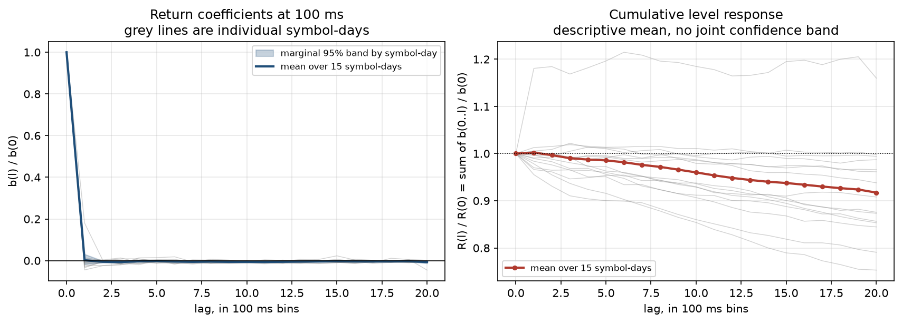

# Audit history

Corrections made to earlier versions of this project, kept so the history of
each claim stays visible. Current results are in
[detailed_results.md](detailed_results.md). The algebraic audit itself is in
[kernel_audit.md](kernel_audit.md), the primary-source literature check in
[literature_audit_2026.md](literature_audit_2026.md), and two provenance
corrections to the input data (a daily-bar date shift and the rebuilt MSFT
metaorder file) in [DATA.md](../DATA.md#provenance-corrections-found-along-the-way).

## Audit correction: returns are not price levels

**On the same fifteen symbol-days, the old 100 ms relaxation and scheduling
conclusions are withdrawn.** The regression fits returns. Its lag coefficients
measure further price changes, while surviving price displacement is their
cumulative sum. From the committed fitted means:

| horizon | old quantity, return response / initial | corrected level response / initial |
|---|---:|---:|
| 100 ms | +0.002048 | **1.002048** |
| 1 second | -0.005938 | **0.960109** |
| 2 seconds | -0.006563 | **0.917296** |

These are descriptive means over fifteen sessions, not causal effects. There
is no cumulative confidence interval: the committed marginal intervals do not
identify covariance across lags. The last supported horizon is two seconds.
Zero additional return does not imply zero remaining impact.
[Full diagnostic](../reports/kernel_audit/return_vs_level.csv),
[audit and limits](kernel_audit.md), and
[verified literature through 2026-09-06](literature_audit_2026.md).

```bash
python scripts/audit_kernel_response.py --check
```

This command uses only committed aggregates and the Python standard library.
The earlier schedule runner now refuses to publish costs until level response,
execution-price convention and horizon are consistent. The conditional-impact
comparison (section 1 of [detailed_results.md](detailed_results.md)) already
accumulates returns correctly; its existing numbers
are retained. **What failed was the interpretation of return coefficients as
lasting impact, and the execution claim built on it.**

## Scheduling: historical result withdrawn after the kernel audit

**Scope: fifteen symbol-days, 1,800 historical model replays over 600-second
windows. These are archived outputs, not validated execution costs.**
[The retained source tables](../reports/schedule/saving_vs_twap.csv) record what
was previously reported; they are not silently overwritten by a different model.

| historical output, 1% order | TWAP | old propagator schedule | Almgren-Chriss |
|---|---:|---:|---:|
| model impact cost per share | $0.002463 | $0.002463 | $0.003824 |
| reported relative saving | n/a | -0.000% | -55.2% |
| remaining-inventory variance / TWAP | 1.000 | 1.000 | 0.486 |

The earlier inference was that an almost instantaneous fitted kernel made
TWAP optimal and front-loading cost 55% more. **That inference is withdrawn.**
`execution.fit_linear_kernel` fits returns, but the runner treated those
coefficients as surviving level impact. Its quadratic objective used half of
instantaneous impact while its exponential replay charged all of it, and a
600-second schedule used zero-padded coefficients fitted over at most 60 seconds.
Those are different cost models even before empirical uncertainty is considered.

The closed-form level-kernel results of
[Gatheral, Schied and Slynko (2012)](https://onlinelibrary.wiley.com/doi/full/10.1111/j.1467-9965.2011.00478.x)
and [Obizhaeva and Wang (2013)](https://web.mit.edu/wangj/www/pap/ObizhaevaWang13.pdf)
remain useful mathematical controls. The tested algebraic helpers are retained
for typed level responses. Raw return coefficients are rejected until
explicitly accumulated, beyond-fit tails require a declared policy, and replay
uses the exact quadratic impact objective optimized by the solver. The
empirical runner still fails before fitting or writing outputs because these
algebra repairs do not justify a causal level-impact model. Neither a better
execution schedule nor the claimed absence of exploitable memory has been
established on this sample.

### The 100 ms evidence, with the estimand corrected



The committed shape table contains means of normalized **return** coefficients
b(l), fitted on 100 ms bars. The audit correction above accumulates them
into normalized level response R(l). The old and corrected interpretations are:

| existing observation | earlier inference | corrected inference |
|---|---|---|
| b(1)/b(0) = +0.0020, marginal interval includes zero | relaxation complete within 100 ms | R(1)/R(0) = 1.0020; no evidence of complete level relaxation |
| negative average return coefficients after lag 1 | reversion distinct from impact decay | negative increments are compatible with a declining positive level response |
| selected L above 1 on 12 of 15 sessions | a test of execution memory | selected-validation return fit only |

The old 100 ms [coefficient table](../reports/kernel_100ms/kernel_shape.csv) and
[selection table](../reports/kernel_100ms/per_session.csv) are retained. The old
`verdict.csv` is a historical interpretation and is withdrawn. The per-lag bands
are marginal and were not corrected for searching across lags; they do not
establish a joint significance claim. Hyperparameters were selected on the same
tail whose R2 was reported. No new model is fitted to that already examined tail.

**What did not work:** neither finer return bars nor the old cost replay
established that impact disappears within 100 ms. A cumulative point estimate
at two seconds is recoverable; its joint uncertainty, causal interpretation and
extension to a ten-minute execution horizon are not recoverable from these
committed summaries alone.

## Historical and corrected conditional-impact reports

`reports/conditional_impact/` holds the conditional-impact tables as first
published. `reports/conditional_impact_corrected/` rebuilds them after a
cutoff repair: training orders must now finish before the train/test split,
and the eight orders that cross it are excluded from both sides. The
largest change in any model's median R² is 0.00033, recorded per model in
[historical_vs_corrected.csv](../reports/conditional_impact_corrected/historical_vs_corrected.csv).

## Corrections of 2026-10-23

A review before publishing found the following. None changes a headline
number in the README.

| what | old | new | why |
|---|---|---|---|
| `reports/metaorder/impact_bins.csv`, `impact_over_sigma` | divided by σ_D = 0.0106 | divided by σ_D = 0.010381 (every value 2.1% larger) | `run_metaorder_impact.py` hardcoded a rounded σ_D for MSFT 2024-06-03; it now reads `data/session_meta.csv` like every other script. The fitted exponent, 0.370, is unchanged because a constant σ only moves the intercept. |
| `reports/kernel_100ms/per_session.csv`, `half_life_bins` | 1 bin on 13 sessions, empty on 2 | empty on all 15 | The old value was a half-life of the return coefficients, the withdrawn reading above. Measured on the cumulative level response, no session falls to half its initial level inside the fitted lags. Every other column is unchanged, and `kernel_shape.csv` reproduces byte for byte from the local 100 ms bars. |
| `figs/kernel_100ms.png` | right panel titled "a band straddling zero is no memory" | right panel shows the cumulative level response with no joint band | Same withdrawn reading. `reports/kernel_100ms/` gains `return_response_diagnostics.csv` and an `input_manifest.csv` hashing the uncommitted 100 ms bars. |
| `scripts/summarize_normaliser_comparison.py --check` | failed under pandas 3.x | passes | It compared floats byte for byte; `read_csv` parses some values one ulp apart across pandas versions. Values are unchanged. |
| volatility shift in section 1 of the detailed results | 0.63 and 0.68 quoted without a source | same values, now in `reports/volatility_shift/`; rank correlation 0.17 added | The Pearson correlation is carried mostly by two sessions whose volatility did not fall. |
| size of the 100 ms bars | 57 MB in DATA.md, about 170 MB in a docstring | 60,038,738 bytes | Measured on the local files; the rebuild time (613 s) was dropped because it was not recorded anywhere. |
| trades pull on disk | 2.65 GB, not recorded in a file | 2,645,493,814 bytes in `data/cross_section/pull_manifest.csv` | Measured on the local extracts. |
| DATA.md details | AAPL trades validated on five sessions; unsided prints about 32% of RTH volume; about 28 MB committed | three sessions (the other two fall outside the trades window); 24% to 32%; about 31 MB | Checked against `reports/cross_section/trades_validation.csv` and the tracked file sizes. |
